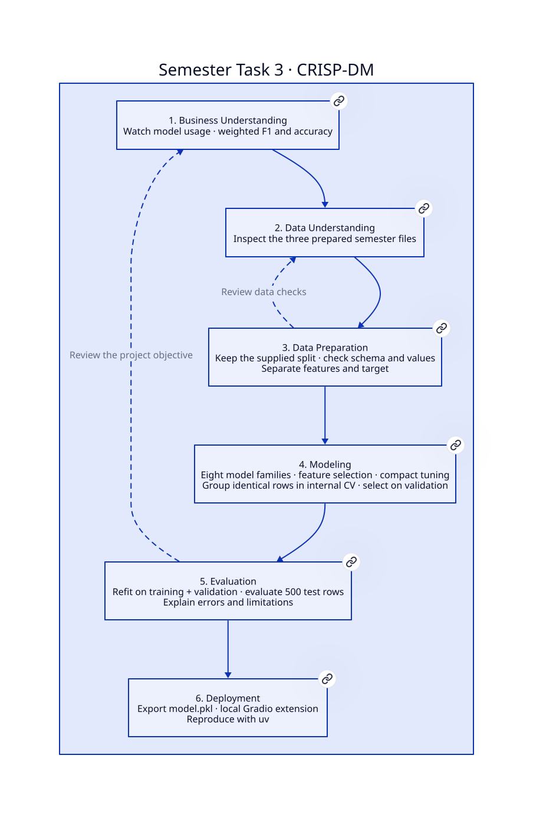
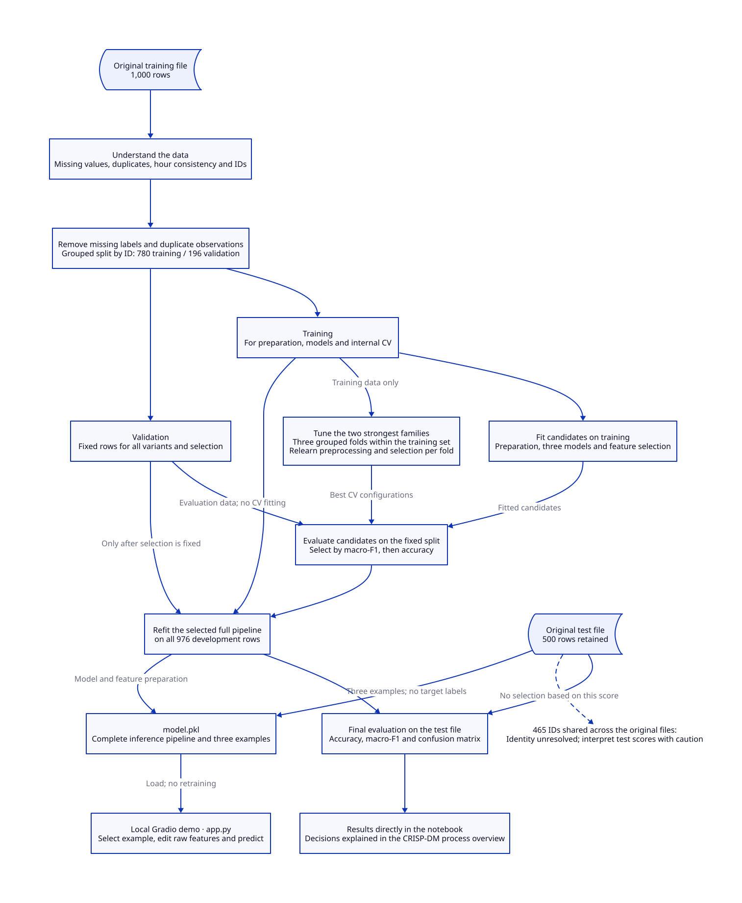

# CRISP-DM Process Overview

This project classifies whether a customer uses the latest model of a sports/triathlon watch
from customer, training and service features. It combines data checks, preparation, model
comparison and evaluation across the six CRISP-DM phases.

The full code and results are available in the [notebook](data_science.ipynb).
This overview explains the methodological decisions and data flow.



[D2 source](docs/process.d2)

## 1. Business Understanding

### Question and objective

Which preparation steps and classification method most reliably distinguish users of the
latest watch model from users of an older model in the available data?

The target `User of latest model` describes observed usage:

| Label | Meaning |
|---|---|
| 0 | Uses an older model |
| 1 | Uses the latest model |

The project evaluates both the effect of preparation and the performance of different model
families. A simple logistic regression provides the starting point. Further variants are
compared under the same validation conditions. The aim is a transparent classification workflow
using simple processing steps. A false positive incorrectly classifies a user of an older
model as a user of the latest model; a false negative misses actual use of the latest model.
Both error types are examined without assuming unsupported business costs.

### Evaluation criteria

The main selection metric is **macro-F1**, the mean of the two class-specific F1 scores,
which gives both classes equal weight. **Accuracy** adds the proportion of correctly classified
observations. The difference between training and validation macro-F1 indicates possible overfitting.

Preparation and model configuration are selected using the validation set. The test file is
evaluated after fixing the configuration. Because the same validation set supports several
decisions, its scores should be interpreted as development results.

[Notebook: Business Understanding](data_science.ipynb#phase-1)

## 2. Data Understanding

### Data and initial inspection

The analysis uses two unchanged CSV files:

| File in `data/` | Rows | Columns | Purpose |
|---|---:|---:|---|
| `triathlon_watch_training_data_final.csv` | 1,000 | 21 | Exploration, training and validation |
| `triathlon_watch_test_data_final.csv` | 500 | 21 | Final evaluation |

The training file is inspected with pandas. A preview and summaries of data types, missing
values, unique values and descriptive statistics establish its structure. Histograms show
selected distributions and unusual values. Initial checks of the test file cover only its
schema, size and overlapping identifiers.

### Data quality findings

| Finding in the training file | Count / observation |
|---|---|
| Completely empty rows | 21 |
| Missing target values | 22 |
| Duplicate labeled observations, excluding ID | 2 |
| Negative ages | 10 |
| Negative calorie values | 2 |
| Total hours inconsistent with the sum of the three sports | 5 |
| Unusual country values | `Germayn`, `UnknownLand` |

These findings overlap. For example, completely empty rows are already included in the
missing-target count. The counts should therefore not be added together.

For 949 of 954 rows with complete training-hour values, total hours equal swimming, biking
and running hours combined, allowing for rounding. Five rows instead contain 100 total hours
while their components sum to approximately 11–23 hours. The check allows a tolerance of
0.03 hours. This motivates the explicit assumption that total hours cover these three sports.

The two files share 465 IDs. Whether these refer to the same people or were assigned
independently in each file is unresolved. This uncertainty limits the final interpretation.

[Notebook: Data Understanding](data_science.ipynb#phase-2)

## 3. Data Preparation

### Establish training and validation sets

Observations without a target are removed from the development file. Duplicate labeled rows
are reduced to one observation before splitting, leaving **976 rows**.

`GroupShuffleSplit` separates these by ID with seed 42:

- **780 training rows** for learning models and processing parameters.
- **196 validation rows** for comparing variants.

The same ID cannot occur in both subsets. Class 1 accounts for approximately 40.9% of training
and 43.9% of validation rows. The split respects groups but does not enforce exactly equal
class proportions.

All variants use the same validation rows and targets. The separate test file retains all
500 observations. Changes affect only in-memory DataFrames; checksums verify that the input
files remain unchanged.

### Features and cleaning rules

`make_features()` separates ID and target from the model inputs. The date becomes a day
offset from the fixed reference date 2024-01-01. Negative offsets are valid for earlier dates.
There are **19 input fields** before encoding: eleven numeric and eight categorical.

The cleaned variant applies fixed rules:

- Correct `Germayn` to `Germany`; treat `UnknownLand` as missing.
- Treat negative numeric measurements and counts as missing, excluding the date offset.
- Treat weekly hours above 168 as invalid.
- When all individual hour values are present and valid, treat total hours as missing if they
  differ from their sum by more than 0.03 hours. The total is then imputed from the respective
  training data. This sum rule is a domain assumption, not confirmed metadata.

Other extreme values remain unless a clear error rule applies. Evaluation rows are not
removed because of missing or unusual features.

### Processing pipeline

`make_pipeline()` combines imputation, optional standardization, one-hot encoding, optional
feature selection and the classifier.

Numeric missing values are replaced with the mean or median; categorical missing values use
the most frequent training category. Unseen categories are tolerated during application, and
entirely missing columns remain in the schema. All learned processing parameters come from
fitting the pipeline. Cross-validation relearns them within each training fold.

### Compare preparation variants

Four variants use the same logistic regression with fixed starting parameters: `C=1`,
solver `liblinear` and seed 42.

| Variant | Numeric imputation | Cleaning rules | Standardization |
|---|---|---|---|
| Minimal | Mean | No | No |
| Median | Median | No | No |
| Cleaned | Median | Yes | No |
| Cleaned + scaled | Median | Yes | Yes |

The cleaned variant bundles country and numeric rules. Its combined effect can be evaluated,
but the contribution of each individual rule is not isolated.

| Variant | Validation accuracy | Validation macro-F1 |
|---|---:|---:|
| Minimal | 0.740 | 0.732 |
| Median | 0.745 | 0.738 |
| Cleaned | 0.755 | 0.748 |
| Cleaned + scaled | 0.755 | 0.748 |

**Cleaned** is selected. Validation macro-F1 rises from 0.732 for the minimal baseline to
0.748, a relative increase of approximately **2.2%**. Cleaned and Cleaned + scaled achieve
the same scores here, so the first-listed variant is retained. The complete notebook table
also includes training scores, the overfitting gap and changes from baseline. This improvement
describes the observed difference on the fixed validation set.

The selected preparation is retained for the model comparison. Exact macro-F1 ties retain
the first-listed preparation variant.

[Notebook: Data Preparation](data_science.ipynb#phase-3)

## 4. Modeling

### Model families and feature selection

The comparison includes **logistic regression**, **decision tree** and **random forest**,
all using the previously selected preparation. “Baseline” here refers to each model family's
starting configuration after the preparation comparison. It therefore differs from the minimal
initial logistic baseline in Phase 3.

All three models are then retrained with feature selection. `SelectFromModel` with a random
forest retains encoded features whose importance reaches at least the median. Selection
happens after one-hot encoding, so it refers to encoded columns rather than the original
19 inputs. The notebook reports the encoded and retained column counts for each model.
This describes the selection step, rather than explaining causal effects or individual
features' importance in the final model. All three feature-selection variants initially
reduce 47 encoded columns to 24. The selector is also relearned during the final refit.

### Tune hyperparameters

The two strongest model families on validation are examined with `GridSearchCV`. Three
`GroupKFold` folds within the 780 training rows keep identical IDs together. The full pipeline
is fitted again in each training fold. Neither validation nor the test file is part of these
cross-validation folds.

The search space is deliberately small:

| Model family | Parameters searched |
|---|---|
| Logistic regression | Regularization `C`, class weighting |
| Random forest | Maximum depth, minimum leaf size |

The actual searches cover logistic regression and random forest. A search space is also
defined for the decision tree, but it is not searched because that family is outside the top
two on the fixed split.

The search also checks whether to use feature selection. Selection of encoded features is
therefore relearned within each training fold.

### Select the final configuration

The results table contains three baseline models, three feature-selection variants and two
tuned variants. Selection uses the highest validation macro-F1. Ties are resolved by higher
validation accuracy; remaining ties retain the order of the variants.

On the fixed split, **logistic regression with cleaned data and feature selection** wins:
validation macro-F1 is **0.754**, compared with **0.748** without selection. Classifier
parameters remain at their starting values (`C=1`, `class_weight=None`), without standardization.
The tuned logistic variant reaches 0.752. These small differences support a choice within
this workflow, not a claim of general superiority. The configuration is fixed before the
final evaluation.

### Sensitivity to the split

Five grouped splits, including the original split, compare the logistic-regression and
random-forest baseline configurations. The previously selected preparation remains fixed;
imputation, encoding and the model are refitted on each split's training subset. The compact
notebook table shows macro-F1 scores. This check describes the sensitivity of fixed
configurations. It repeats neither preparation selection nor tuning and does not independently
evaluate the entire selection procedure. Model choice still follows the original fixed split.
The random-forest baseline leads in four of the five checks. These two baseline configurations
are not equivalent to the entire selection procedure or the final variant with feature selection.

[Notebook: Modeling](data_science.ipynb#phase-4)

## 5. Evaluation

### Evaluate the fixed model

The selected pipeline is refitted on all 976 development rows, including its processing
parameters. It is then applied to all 500 test rows. Test scores do not drive model selection
within this workflow. Because the provided file has already been evaluated during the project,
a rerun does not constitute new independent performance evidence. One inconsistent total in
that file is handled using the same rule justified from development data; all test rows and
labels are retained.

| Metric | Validation before refitting | Provided test file |
|---|---:|---:|
| Accuracy | 0.760 | 0.790 |
| Macro-F1 | 0.754 | 0.780 |

The confusion matrix shows 251 correctly classified users of older models and 144 correctly
classified users of the latest model, alongside 50 false positives and 55 false negatives.
This misses 55 of the 199 actual users of the latest model, approximately 27.6%. On this
dataset, the model therefore fails to recognize a substantial share of latest-model users.
The classification report adds precision, recall and F1 for each class.

### Interpret the results

Preparation improves the initial logistic baseline on the fixed validation set. Feature
selection adds a small gain there, while tuning does not outperform the selected configuration.
The sensitivity check also shows that the baseline ranking depends on the split. Selection
of logistic regression with cleaned data and feature selection therefore applies to the
fixed development split.

Interpretation is limited by:

- The unresolved meaning of 465 IDs shared across the original files.
- Reuse of the same validation set for several development decisions.
- Unconfirmed timing of features relative to observed model usage.

Validation and test are different samples, and the final model is trained on more development
data. Higher test scores therefore do not isolate the effect of refitting. Small score
differences do not establish statistical significance either. Results concern the available
data and do not support claims about future purchases or causal effects.

[Notebook: Evaluation](data_science.ipynb#phase-5)

## 6. Deployment

### Deliver and reproduce the analysis

The handover consists of the executable notebook, README, this process overview and the two
D2 diagrams. All code, result tables and figures are contained in the notebook. Required
Python packages are listed in `requirements.txt`.

Use the repository root as the working directory and the interpreter from `.venv` as the
notebook kernel. Restart the kernel and run all cells in order. The final cell checks retained
test rows, separation of internal groups and unchanged input files. SHA-256 checksums and
package versions are also displayed.

### Data flow and architecture



[D2 source](docs/architecture.d2)

The architecture separates data inspection, model development and final evaluation.
Cross-validation uses only the training branch. After selection, the chosen pipeline is
refitted on training plus validation; the test file feeds only the final evaluation.

Regenerate the diagrams with the D2 CLI:

```bash
d2 docs/process.d2 docs/process.svg
d2 docs/architecture.d2 docs/architecture.svg
```

[Notebook: Deployment](data_science.ipynb#phase-6)

## References

- [CRISP-DM process model](https://www.ibm.com/docs/en/SS3RA7_19.0.0/pdf/ModelerCRISPDM.pdf)
- [scikit-learn: Common pitfalls](https://scikit-learn.org/stable/common_pitfalls.html)
- [D2 documentation](https://d2lang.com/tour/intro/)
