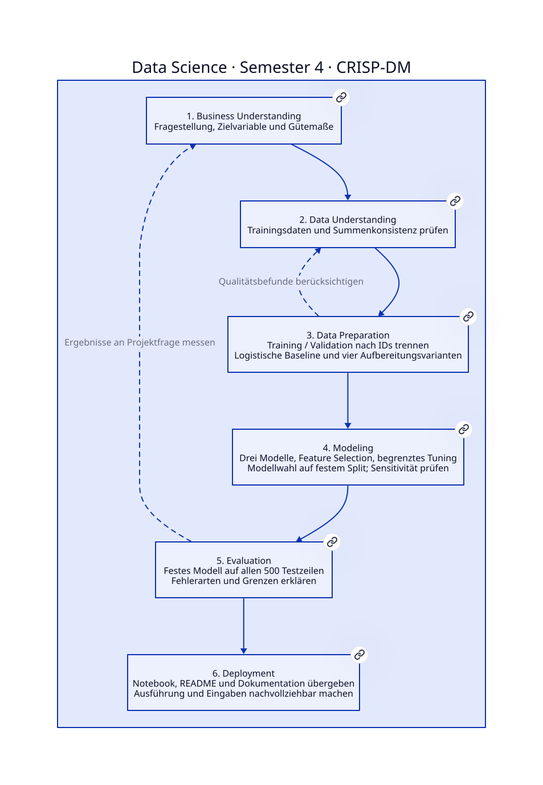
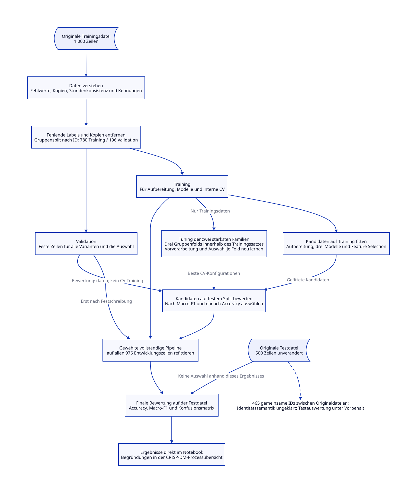

# CRISP-DM-Prozessübersicht

Das Projekt untersucht, wie sich die Nutzung des aktuellen Modells einer Sport-/Triathlon-Uhr
anhand von Kunden-, Trainings- und Servicemerkmalen klassifizieren lässt. Der Ablauf verbindet
Datenprüfung, Aufbereitung, Modellvergleich und Bewertung entlang der sechs CRISP-DM-Phasen.

Der vollständige Code und die Ergebnisse stehen im [Notebook](data_science.ipynb).
Diese Übersicht erläutert die methodischen Entscheidungen und den Datenfluss.



[D2-Quelldatei](docs/prozess.d2)

## 1. Business Understanding

### Fragestellung und Ziel

Welche Aufbereitung und welches Klassifikationsverfahren unterscheiden auf den vorliegenden
Daten am zuverlässigsten zwischen der Nutzung eines aktuellen und eines älteren Uhrenmodells?

Die Zielvariable `User of latest model` beschreibt den beobachteten Nutzungsstatus:

| Label | Bedeutung |
|---|---|
| 0 | Nutzung eines älteren Modells |
| 1 | Nutzung des aktuellen Modells |

Das Projekt bewertet sowohl den Einfluss der Datenaufbereitung als auch die Leistung
unterschiedlicher Modellfamilien. Eine einfache logistische Regression bildet den Ausgangspunkt.
Weitere Varianten werden unter denselben Validierungsbedingungen verglichen. Die Analyse soll
zeigen, welche einfache Verarbeitung den beobachteten Nutzungsstatus nachvollziehbar klassifiziert.
Ein False Positive ordnet eine Person mit älterem Modell fälschlich dem aktuellen Modell zu;
ein False Negative übersieht eine tatsächliche Nutzung des aktuellen Modells. Beide Fehlerarten
werden betrachtet, ohne ungesicherte betriebliche Kosten anzunehmen.

### Bewertungsmaßstab

Das zentrale Auswahlkriterium ist **Macro-F1**, der Mittelwert der F1-Werte beider Klassen.
Dadurch werden beide Klassen gleich gewichtet. **Accuracy** ergänzt den Vergleich um den
Anteil korrekt klassifizierter Beobachtungen. Die Differenz zwischen Trainings- und
Validierungs-Macro-F1 dient als Hinweis auf Überanpassung.

Aufbereitung und Modellkonfiguration werden anhand der Validierungsdaten (Validation) ausgewählt. Die Testdatei
wird nach Festlegung der Konfiguration bewertet. Da dieselbe Validation für mehrere
Entscheidungen verwendet wird, sind ihre Ergebnisse als Entwicklungswerte einzuordnen.

[Notebook: Business Understanding](data_science.ipynb#phase-1)

## 2. Data Understanding

### Datenbasis und erste Prüfung

Die Analyse verwendet zwei unveränderte CSV-Dateien:

| Datei in `data/` | Zeilen | Spalten | Verwendung |
|---|---:|---:|---|
| `triathlon_watch_training_data_final.csv` | 1.000 | 21 | Exploration, Training und Validation |
| `triathlon_watch_test_data_final.csv` | 500 | 21 | Abschließende Bewertung |

Die Trainingsdatei wird mit pandas untersucht. Eine Vorschau sowie Übersichten zu Datentypen,
Fehlwerten, eindeutigen Werten und statistischen Kennzahlen beschreiben die Datenstruktur.
Histogramme zeigen ausgewählte Verteilungen und auffällige Werte. Die Testdatei wird zunächst
nur auf Schema, Größe und Kennungsüberschneidungen geprüft.

### Qualitätsbefunde

| Befund in der Trainingsdatei | Anzahl / Beobachtung |
|---|---|
| Vollständig leere Zeilen | 21 |
| Fehlende Zielwerte | 22 |
| Kopien unter gelabelten Beobachtungen, ohne Berücksichtigung der ID | 2 |
| Negative Alterswerte | 10 |
| Negative Kalorienwerte | 2 |
| Gesamtstunden abweichend von der Summe der drei Sportarten | 5 |
| Auffällige Länderwerte | `Germayn`, `UnknownLand` |

Die Befunde überschneiden sich. Beispielsweise sind vollständig leere Zeilen bereits in der
Anzahl fehlender Zielwerte enthalten. Sie werden deshalb nicht addiert.

Bei 949 von 954 Zeilen mit vollständigen Stundenangaben entspricht die Gesamtzeit der Summe
aus Schwimmen, Radfahren und Laufen bis auf Rundung. Fünf Zeilen enthalten dagegen
100 Gesamtstunden bei einer Summe von ungefähr 11 bis 23 Stunden. Die Prüfung verwendet
0,03 Stunden Toleranz. Daraus leiten wir die explizite Annahme ab, dass die Gesamtzeit diese
drei Sportarten umfasst.

Zwischen beiden Dateien gibt es 465 gemeinsame IDs. Ob sie dieselben Personen bezeichnen oder
in den Dateien unabhängig vergeben wurden, ist ungeklärt. Diese Unsicherheit wird bei der
abschließenden Interpretation berücksichtigt.

[Notebook: Data Understanding](data_science.ipynb#phase-2)

## 3. Data Preparation

### Trainings- und Validierungsdaten festlegen

Beobachtungen ohne Zielwert werden aus der Entwicklungsdatei entfernt. Kopierte gelabelte
Zeilen werden vor dem Split auf eine Beobachtung reduziert. Es verbleiben **976 Zeilen**.

`GroupShuffleSplit` teilt diese mit Seed 42 nach ID auf:

- **780 Trainingszeilen** zum Lernen der Modelle und Verarbeitungsparameter.
- **196 Validierungszeilen** zum Vergleich der Varianten.

Gleiche IDs kommen innerhalb dieses Splits nicht in beiden Teilmengen vor. Der Anteil von
Klasse 1 beträgt ungefähr 40,9 % im Training und 43,9 % in der Validation. Die Aufteilung
berücksichtigt Gruppen, erzwingt aber keine exakt gleiche Klassenverteilung.

Alle Varianten verwenden dieselben Validierungszeilen und Zielwerte. Die separate Testdatei
bleibt mit sämtlichen 500 Beobachtungen erhalten. Veränderungen erfolgen ausschließlich an
DataFrames im Speicher; Prüfsummen kontrollieren die unveränderten Eingabedateien.

### Merkmale und Bereinigungsregeln

Die Funktion `make_features()` trennt ID und Zielvariable von den Modelleingaben. Das Datum
wird als Tagesoffset zum festen Bezugspunkt 01.01.2024 dargestellt. Negative Offsets sind
für frühere Datumswerte gültig. Es ergeben sich **19 Eingabefelder**: elf numerische und
acht kategoriale Felder vor der Kodierung.

Die bereinigte Variante verwendet feste Regeln:

- `Germayn` wird zu `Germany` korrigiert; `UnknownLand` wird als fehlend behandelt.
- Negative numerische Mess- und Zählwerte werden auf fehlend gesetzt. Der Datums-Offset ist davon ausgenommen.
- Wochenstunden über 168 werden als ungültig behandelt.
- Bei vollständigen gültigen Einzelstunden werden Gesamtstunden mit mehr als 0,03 Stunden
  Abweichung von deren Summe auf fehlend gesetzt. Sie werden anschließend aus den jeweiligen
  Trainingsdaten imputiert. Die Summenannahme ist eine fachliche Annahme, keine gesicherte Metadatenangabe.

Weitere Extremwerte bleiben erhalten, sofern keine eindeutige Fehlerregel vorliegt.
Bewertungszeilen werden wegen fehlender oder auffälliger Merkmale nicht entfernt.

### Verarbeitungspipeline

`make_pipeline()` verbindet Imputation, optionale Standardisierung, One-Hot-Encoding,
optionale Feature Selection und das Klassifikationsmodell.

Numerische Fehlwerte werden durch Mittelwert oder Median ersetzt, kategoriale Fehlwerte durch
die häufigste Trainingskategorie. Unbekannte Kategorien werden beim Anwenden toleriert;
vollständig fehlende Spalten bleiben im Schema erhalten. Alle gelernten Verarbeitungsparameter
entstehen beim Training der Pipeline. Innerhalb der Kreuzvalidierung werden sie je
Trainingsfold neu bestimmt.

### Aufbereitungsvarianten vergleichen

Vier Varianten werden mit derselben logistischen Regression verglichen. Ihre Ausgangsparameter
bleiben konstant: `C=1`, Solver `liblinear`, Seed 42.

| Variante | Numerische Imputation | Bereinigungsregeln | Standardisierung |
|---|---|---|---|
| Minimal | Mittelwert | Nein | Nein |
| Median | Median | Nein | Nein |
| Bereinigt | Median | Ja | Nein |
| Bereinigt + skaliert | Median | Ja | Ja |

Die Bereinigungsvariante bündelt Länder- und Zahlenregeln. Ihr Gesamteffekt lässt sich damit
bewerten; der Beitrag jeder einzelnen Regel wird nicht isoliert gemessen.

| Variante | Accuracy Validation | Macro-F1 Validation |
|---|---:|---:|
| Minimal | 0,740 | 0,732 |
| Median | 0,745 | 0,738 |
| Bereinigt | 0,755 | 0,748 |
| Bereinigt + skaliert | 0,755 | 0,748 |

Gewählt wird **Bereinigt**. Der Validierungs-Macro-F1 steigt gegenüber der minimalen
Ausgangsbaseline von 0,732 auf 0,748, relativ um etwa **2,2 %**.
Bereinigt und Bereinigt + skaliert erreichen hier dieselben Werte; die zuerst aufgeführte
Variante bleibt erhalten. Die vollständige Ergebnistabelle im Notebook enthält auch
Trainingswerte, Überanpassungsabstand und Änderungen zur Baseline. Diese Verbesserung
beschreibt den beobachteten Unterschied auf der festen Validation.

Die gewählte Aufbereitung wird für den folgenden Modellvergleich beibehalten. Bei exakt
gleichem Macro-F1 bleibt die zuerst aufgeführte Aufbereitungsvariante erhalten.

[Notebook: Data Preparation](data_science.ipynb#phase-3)

## 4. Modeling

### Modellfamilien und Feature Selection

Verglichen werden **logistische Regression**, **Entscheidungsbaum** und **Random Forest**.
Alle erhalten dieselbe zuvor gewählte Aufbereitung. Die Stufe „Baseline“ bezeichnet hier die
Ausgangskonfiguration jeder Modellfamilie nach diesem Aufbereitungsvergleich. Sie unterscheidet
sich somit von der minimalen logistischen Ausgangsbaseline aus Phase 3.

Anschließend werden die drei Modelle mit Feature Selection erneut trainiert. Ein
`SelectFromModel`-Schritt mit Random Forest behält kodierte Merkmale, deren Importance
mindestens den Median erreicht. Die Auswahl findet nach dem One-Hot-Encoding statt und
bezieht sich auf kodierte Spalten, nicht auf die ursprünglichen 19 Eingabefelder. Das Notebook
zeigt je Modell die Zahl kodierter und beibehaltener Spalten. Diese Auswahl beschreibt den
Selektionsschritt; sie ist keine Erklärung kausaler Einflüsse oder der Bedeutung einzelner
Merkmale im finalen Modell. In allen drei Feature-Selection-Varianten werden zunächst
47 kodierte Spalten auf 24 reduziert. Beim späteren erneuten Training der gewählten Pipeline
wird auch der Selektor neu gelernt.

### Hyperparameter abstimmen

Die zwei auf der Validation stärksten Modellfamilien werden mit `GridSearchCV` untersucht.
Drei `GroupKFold`-Faltungen innerhalb der 780 Trainingszeilen halten gleiche IDs zusammen.
Die vollständige Pipeline wird je Trainingsfold neu gelernt. Die Validation und die Testdatei
sind nicht Teil dieser CV-Folds.

Der Suchraum bleibt begrenzt:

| Modellfamilie | Untersuchte Parameter |
|---|---|
| Logistische Regression | Regularisierung `C`, Klassengewichtung |
| Random Forest | Maximale Tiefe, minimale Blattgröße |

Tatsächlich durchsucht werden Logistische Regression und Random Forest. Für den
Entscheidungsbaum ist ebenfalls ein Suchraum definiert; er gehört auf dem festen Split
nicht zu den zwei ausgewählten Familien und wird deshalb nicht durchsucht.

Die Verwendung von Feature Selection wird ebenfalls geprüft. Dadurch wird die Auswahl der
kodierten Merkmale innerhalb der jeweiligen Trainingsfolds erneut gelernt.

### Finale Konfiguration auswählen

Die Ergebnistabelle enthält drei Ausgangsmodelle, drei Feature-Selection-Varianten und zwei
getunte Varianten. Gewählt wird der höchste Validierungs-Macro-F1. Bei Gleichstand entscheidet
die höhere Validierungs-Accuracy; verbleibende Gleichstände behalten die Reihenfolge der
Varianten bei.

Auf dem festen Split gewinnt die **logistische Regression mit bereinigten Daten und
Feature Selection**: Validierungs-Macro-F1 **0,754**, gegenüber **0,748** ohne Selektion.
Ihre Klassifikatorparameter bleiben in der Ausgangskonfiguration (`C=1`, `class_weight=None`);
es wird nicht standardisiert. Die getunte logistische Variante erreicht 0,752. Diese kleinen
Unterschiede begründen eine Auswahl im vorliegenden Ablauf, keine allgemeine Überlegenheit.
Die gewählte Konfiguration wird vor der abschließenden Bewertung festgelegt.

### Empfindlichkeit gegenüber der Datenaufteilung

Fünf Gruppensplits einschließlich des ursprünglichen Splits vergleichen die Ausgangskonfigurationen
von logistischer Regression und Random Forest. Die zuvor ausgewählte Aufbereitung bleibt dabei konstant;
Imputation, Kodierung und Modell werden jeweils neu auf dem jeweiligen Training gelernt.
Die kompakte Tabelle im Notebook zeigt die Macro-F1-Werte. Die Prüfung beschreibt die
Empfindlichkeit fester Konfigurationen. Sie wiederholt weder Aufbereitungsauswahl noch Tuning
und ist keine unabhängige Bewertung des gesamten Auswahlverfahrens. Die Modellwahl erfolgt
weiterhin anhand des ursprünglich festgelegten Splits. Bei vier der fünf Prüfaufteilungen
liegt die Random-Forest-Ausgangskonfiguration vorn. Die beiden Ausgangskonfigurationen in dieser
Prüfung sind nicht mit der gesamten Auswahlprozedur oder der finalen Variante mit Selektion
gleichzusetzen.

[Notebook: Modeling](data_science.ipynb#phase-4)

## 5. Evaluation

### Festes Modell bewerten

Die ausgewählte Pipeline wird auf allen 976 Entwicklungszeilen neu trainiert. Dabei werden
auch ihre Verarbeitungsparameter erneut auf diesen Daten gelernt. Anschließend wird sie auf
sämtliche 500 Zeilen der Testdatei angewendet. Die Testwerte bestimmen innerhalb dieses Ablaufs
keine Modellwahl. Da die gelieferte Datei
im Projektverlauf bereits ausgewertet wurde, ist die erneute Ausführung kein neuer unabhängiger
Leistungsnachweis. Eine dort auffällige Summeninkonsistenz wird mit derselben, aus den
Entwicklungsdaten begründeten Regel behandelt; sämtliche Testzeilen und Labels bleiben erhalten.

| Kennzahl | Validation vor erneutem Training | Gelieferte Testdatei |
|---|---:|---:|
| Accuracy | 0,760 | 0,790 |
| Macro-F1 | 0,754 | 0,780 |

Die Konfusionsmatrix zeigt 251 korrekt erkannte Nutzer älterer Modelle und 144 korrekt erkannte
Nutzer des aktuellen Modells. Hinzu kommen 50 False Positives und 55 False Negatives.
Damit werden 55 von 199 tatsächlichen Nutzern des aktuellen Modells übersehen,
also rund 27,6 %. Für diesen Datensatz erkennt das Modell die aktuelle
Nutzung somit nicht zuverlässig bei allen Personen. Der Classification Report ergänzt
Precision, Recall und F1 je Klasse.

### Ergebnisse einordnen

Die Aufbereitung verbessert die logistische Ausgangsbaseline auf der festen Validation.
Feature Selection bringt dort einen kleinen weiteren Zuwachs; die Tuningvarianten übertreffen
die gewählte Konfiguration nicht. Die Sensitivitätsprüfung zeigt zugleich, dass die Rangfolge
der Ausgangsmodelle von der Aufteilung abhängt. Die Auswahl der bereinigten logistischen
Regression mit Selektion gilt deshalb für den festgelegten Entwicklungssplit.

Die Aussagekraft ist durch folgende Punkte begrenzt:

- Die Bedeutung der 465 dateiübergreifend gemeinsamen IDs ist ungeklärt.
- Mehrere Entwicklungsentscheidungen nutzen dieselbe Validation.
- Der Zeitpunkt der Merkmale relativ zur beobachteten Modellnutzung ist nicht gesichert.

Validation und Testdatei sind unterschiedliche Stichproben. Außerdem wurde das finale Modell
mit mehr Entwicklungsdaten trainiert. Die höheren Testwerte belegen deshalb keinen isolierten
Effekt dieses erneuten Trainings. Kleine Kennzahlunterschiede sind auch kein Signifikanznachweis.
Die Ergebnisse beziehen sich auf die vorliegenden Daten und erlauben keine Aussagen über
zukünftige Käufe oder kausale Wirkungen.

[Notebook: Evaluation](data_science.ipynb#phase-5)

## 6. Deployment

### Analyse bereitstellen und reproduzieren

Die Projektübergabe umfasst das ausführbare Notebook, die README, diese Prozessübersicht und
die beiden D2-Diagramme. Code, Ergebnistabellen und Abbildungen stehen vollständig im Notebook.
Die benötigten Python-Pakete sind in `requirements.txt` festgehalten.

Zur Reproduktion dient die Repositorywurzel als Arbeitsverzeichnis und der Interpreter aus
`.venv` als Notebook-Kernel. Das Notebook wird mit frischem Kernel von oben nach unten ausgeführt.
Die Schlusszelle prüft die erhaltenen Testzeilen, die Trennung der internen Gruppen und die
unveränderten Eingabedateien. SHA-256-Prüfsummen und verwendete Paketversionen werden mit ausgegeben.

### Datenfluss und Architektur



[D2-Quelldatei](docs/architektur.d2)

Die Architektur trennt Datenprüfung, Modellentwicklung und abschließende Bewertung. Die
Kreuzvalidierung verwendet ausschließlich den Trainingszweig. Nach der Auswahl wird die
gewählte Pipeline mit Training und Validation erneut trainiert; die Testdatei fließt erst
in die abschließende Bewertung ein.

Die Diagramme können mit der D2 CLI neu erzeugt werden:

```bash
d2 docs/prozess.d2 docs/prozess.svg
d2 docs/architektur.d2 docs/architektur.svg
```

[Notebook: Deployment](data_science.ipynb#phase-6)

## Fachliche Referenzen

- [CRISP-DM: Prozessmodell](https://www.ibm.com/docs/en/SS3RA7_19.0.0/pdf/ModelerCRISPDM.pdf)
- [scikit-learn: Vermeidung typischer Fehler](https://scikit-learn.org/stable/common_pitfalls.html)
- [D2: Dokumentation](https://d2lang.com/tour/intro/)
