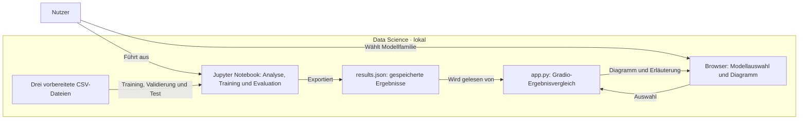

# Data Science — Modellvergleich im 4. Semester

## Overview

Eine Aufbereitung des Semesterprojekts „Task 3: Modeling & Validation“, das ich gemeinsam mit Marco und Dino als Gruppenarbeit umgesetzt habe. Klassifikationsmodelle unterscheiden, ob Kunden das neueste Sportuhrenmodell verwenden. Grundlage sind die drei unveränderten, bereits vorbereiteten Semesterdateien mit ihrer bestehenden Aufteilung in Training, Validierung und Test. Mein Lernziel ist, den Data-Science-Prozess und seine Entscheidungen anhand von CRISP-DM nachvollziehbar zu verstehen.

## Features

- Vollständige Analyse in einem [Jupyter Notebook](data_science.ipynb), gegliedert nach den sechs CRISP-DM-Phasen.
- Vergleich von acht Modellfamilien über Baseline, Feature Selection und Tuning: insgesamt 24 Kandidaten.
- Auswertung mit Accuracy, gewichtetem F1-Score, klassenbezogenen Kennzahlen und Konfusionsmatrix.
- Lokaler Gradio-Explorer zum interaktiven Vergleich der gespeicherten Trainings- und Validierungsergebnisse.
- Separate [Prozessübersicht](CRISP-DM-Process-Overview.md) mit Entscheidungen, Grenzen und D2-Diagrammen.

## Tech Stack

| Bereich | Technologie | Verwendung |
| --- | --- | --- |
| Analyse | Python 3.14, Jupyter | Ausführbarer Analyse- und Modellierungsprozess |
| Daten | pandas, NumPy, CSV | Daten einlesen, prüfen und aufbereitet verwenden |
| Modellierung | scikit-learn | Klassifikation, Feature Selection, Kreuzvalidierung und Tuning |
| Darstellung | Matplotlib, Gradio | Diagramme und interaktiver Ergebnisvergleich |
| Umgebung | uv | Abhängigkeiten installieren und über die Lockdatei festschreiben |
| Dokumentation | Markdown, D2, Mermaid | Prozessbeschreibung und Architekturüberblicke |

### Projektstruktur

```text
data-science-module-s4/
├── data/
│   ├── train_task3.csv              # 585 Trainingszeilen
│   ├── validation_task3.csv         # 196 Validierungszeilen
│   └── final_test_task3.csv         # 500 Testzeilen
├── docs/
│   ├── process.d2                   # CRISP-DM-Ablauf: Quelle
│   ├── process.svg                  # CRISP-DM-Ablauf: Grafik
│   ├── architecture.d2              # Technischer Datenfluss: Quelle
│   └── architecture.svg             # Technischer Datenfluss: Grafik
├── .gitignore                      # Lokale Dateien ausschließen
├── README.md                       # Projektübersicht und Einstieg
├── CRISP-DM-Process-Overview.md     # Entscheidungen und methodische Grenzen
├── data_science.ipynb               # Gesamte Analyse mit Code und Ergebnissen
├── app.py                          # Gradio-Explorer für gespeicherte Ergebnisse
├── results.json                    # Vom Notebook exportierte Ergebnisse
├── pyproject.toml                  # Python-Version und Abhängigkeiten
└── uv.lock                         # Festgeschriebene Abhängigkeitsversionen
```

## Getting Started

Voraussetzungen: Git und [uv](https://docs.astral.sh/uv/getting-started/installation/). Das Projekt verwendet Python 3.14; uv kann die passende Version bereitstellen.

```sh
git clone https://github.com/crnly/data-science-module-s4.git
cd data-science-module-s4
uv sync --locked
uv run python app.py
```

Anschließend [localhost:7860](http://127.0.0.1:7860/) öffnen. Mit Strg+C beenden. Der Explorer liest `results.json`; die Modellauswahl filtert nur die Anzeige.

Für die Analyse `data_science.ipynb` in VS Code oder Jupyter öffnen, `.venv` als Kernel und den Repository-Ordner als Arbeitsverzeichnis verwenden. Alle Zellen ausführen; dabei wird auch `results.json` neu erstellt. JupyterLab lässt sich bei Bedarf mit `uv run --with jupyterlab jupyter lab` starten.

**Prüfen:** `uv sync --locked --check` prüft die Umgebung. Die Daten-, CV-Gruppen- und Exportprüfungen laufen beim vollständigen Ausführen des Notebooks.

## Engineering & Quality

Die sieben Referenzen geben meiner persönlichen Weiterentwicklung eine Richtung. Ich möchte die dahinterstehenden Prinzipien an echten Projekten selbst anwenden, Erfahrungen sammeln und dadurch die Qualität meiner Arbeit Schritt für Schritt verbessern.

Methodisch bleibt dies eine Auswertung vorbereiteter Kursdaten: Frühere Imputation vor der Datenaufteilung, fehlende Personenkennungen und die historische Nutzung der Testdatei begrenzen die Aussagekraft. Die [Prozessübersicht](CRISP-DM-Process-Overview.md#3-data-preparation) erläutert diese Grenzen; unabhängige Leistung bei neuen Kunden ist damit nicht nachgewiesen.

- **SOLID:** Verantwortlichkeiten verständlich trennen. [Analyse und Modelltraining](data_science.ipynb) sowie [Ergebnisanzeige](app.py) sind getrennt; eine vollständige SOLID-Bewertung liegt nicht vor.
- **Test Pyramid:** Prüfungen passend zur Aufgabe einsetzen. Das [Notebook](data_science.ipynb#phase-3) enthält Assertions für Daten, getrennte CV-Gruppen und Ergebnisexport; eine separate automatisierte Testsuite fehlt.
- **CI/CD:** Änderungen reproduzierbar prüfen und veröffentlichen. [Projektkonfiguration](pyproject.toml) und [Lockdatei](uv.lock) halten die Umgebung fest; CI/CD-Workflows sind nicht eingerichtet.
- **OWASP LLM Top 10:** Risiken von LLM-Funktionen verstehen. Das Projekt verwendet keine LLMs; die Referenz ist hier nicht anwendbar.
- **NIST CSF 2.0:** Risiken systematisch erfassen und passende Maßnahmen ableiten. Eine strukturierte Bewertung liegt nicht vor.
- **ISO 27001:** Informationssicherheit nachvollziehbar organisieren und dokumentieren. Eine Bewertung oder Zertifizierung liegt nicht vor.
- **C4 Model:** Systemgrenzen und Datenflüsse verständlich darstellen. Der [vereinfachte Mermaid-Snapshot](#architecture-diagram) zeigt das implementierte System, ohne eine vollständige C4-Modellierung zu beanspruchen. Ausführlicher: [D2-Datenfluss](docs/architecture.svg) ([Quelle](docs/architecture.d2)) und [CRISP-DM-Ablauf](docs/process.svg) ([Quelle](docs/process.d2)).<br>↓ ↓ ↓ ↓ ↓ ↓ ↓ ↓ ↓ ↓

<a id="architecture-diagram"></a>



## License

Für den Projektcode wurde noch keine Lizenz festgelegt. Die drei CSV-Dateien stammen aus dem Semesterprojekt; ihre Weiterverwendungsrechte sind im Repository nicht dokumentiert.
